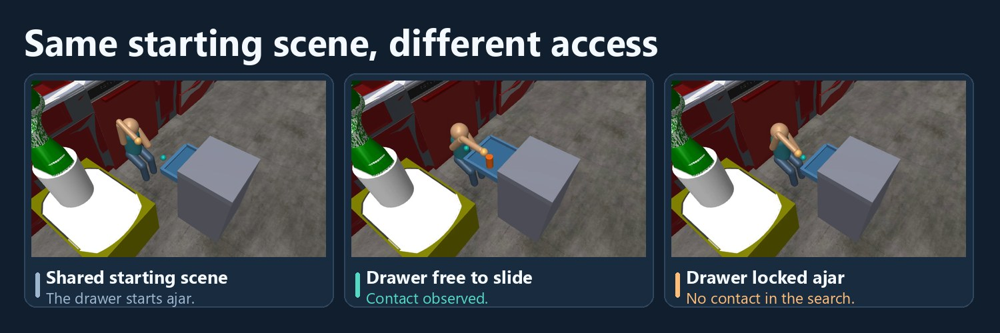

# CARE-VLA

**A replay benchmark for post-task access in simulated homes**

A robot has finished its task and left a drawer slightly open. Can someone pull it far enough to reach the orange marker inside? CARE-VLA tests questions like this by replaying the same kitchen scene under different conditions. A pair of replays can change just one thing, such as whether the drawer is locked or whether the actor can pull the handle.

[Download CARE-VLA v1.2.0](https://github.com/chartgod/CARE-VLA/releases/tag/v1.2.0)



*Both runs start from the frame on the left. To watch them side by side, open `free.mp4` and `locked.mp4` in `Fresh/cases/drawer-L01-S2670100/` inside the dataset ZIP.*

## What the benchmark measures

The dataset contains **280 visual questions** from **72 scene groups** involving rotary trays, drawers, and corridors. There are 28 development questions and 252 test questions. The test set includes questions from three held-out kitchen layouts.

| Task | What the model sees | What it has to decide |
| --- | --- | --- |
| Endpoint forecasting | The scene at the end of the robot's task and a question describing the allowed actions | Will the actor's hand touch the target during replay? |
| Evidence verification | The last frame of the replay and a question about contact | Did the actor touch the target? |

Match a question in `questions.jsonl` to its entry in `labels.jsonl` using the `id` field. For the **56 questions** labeled `observed_contact`, the entry points to a video and a separate check of the distance between the hand and the target. The other **224** carry the label `no_contact_in_search`. This means the simulator tried the allowed actions without finding contact. The label applies only to those actions and that search budget.

## Downloads

| File | Size | Contents |
| --- | ---: | --- |
| [Dataset and replay bundle](https://github.com/chartgod/CARE-VLA/releases/download/v1.2.0/CARE-VLA_Reviewer_Core.zip) | 446 MB | Questions, labels, images, replay clips, raw model responses, scoring scripts, and three MuJoCo cases you can replay on a CPU |
| [Evidence index and figure data](https://github.com/chartgod/CARE-VLA/releases/download/v1.2.0/CARE-VLA_Evidence_Index_and_Figure_Data.zip) | 22 kB | An index linking question IDs to evidence, plus the data used to plot selected figures |

The bundle includes `README_REVIEWER.md` with setup instructions and `SHA256SUMS.txt` with checksums for the archives.

## Reproduce the released results

### Score the archived model responses

With Python 3.11 or newer, run these commands from the folder where you extracted the bundle. Keep `CARE-VLA_Dataset_v1.2.zip` zipped so the scripts can read it directly.

```sh
python -m zipfile -e CARE-VLA_VLM_Audit_20261124.zip vlm
python -I vlm/source/analyze_feedback.py vlm CARE-VLA_Dataset_v1.2.zip scored --experiment vision
python -I Validation/audit_release.py CARE-VLA_Dataset_v1.2.zip scored/vlm_rescored_items.csv audited
```

Compare the new scores in `scored/` with the published scores in `vlm/Results/`. The audit writes its results to `audited/`, including scores for each held-out kitchen and a check for images shared across splits. The archived audit is in `Validation/`.

### Replay three boundary cases on CPU

Extract `CARE-VLA_Table9_Reviewer.zip` and follow the instructions in its `README_REVIEWER.md`. The verifier replays one case where a larger search budget found contact and two cases that remained unresolved. It uses the original 4 mm threshold and combines the three results with the archived records to rebuild Table 9.

To rerun all 36 fresh scene initializations, you also need the separate archive of compiled models listed in the bundle's main README.

## Citation and attribution

> Seung Heon Lee. 2026. *CARE-VLA: A Replay Benchmark for Post-Task Access in Simulated Homes*. Dataset, version 1.2.0. [GitHub release](https://github.com/chartgod/CARE-VLA/releases/tag/v1.2.0).

The [attribution file](ATTRIBUTION.md) lists the RoboCasa scene and asset credits and their licenses.
